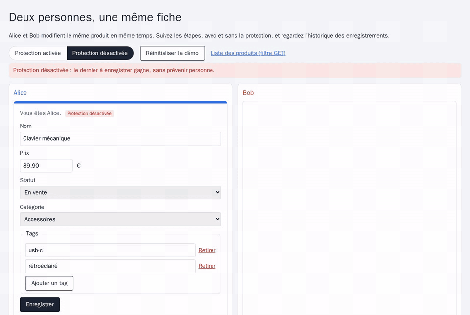

# Form concurrency protection

Prototype. Detects that a record changed between the moment a form was displayed and the moment it was
submitted, so that a user does not silently overwrite someone else's changes. It works like the CSRF
protection: a hidden token is added to every root form and checked on submit, with no change to form types
and no dependency on Doctrine.

The reasoning, the options that were considered and the limits are in [docs/design.md](docs/design.md).



To see it working, [`demo/`](demo/README.md) is a small back-office where two people edit the same product
side by side: `cd demo && docker compose up --build`.

## Usage

Enable the bundle:

```php
// config/bundles.php
return [
    // ...
    LockForm\FormConcurrency\FormConcurrencyBundle::class => ['all' => true],
];
```

Every root form is now protected, except GET forms (searches, filters). On a conflict the form is invalid, with a global error and an error on
each field that changed meanwhile, showing what it holds now, and a checkbox to save the user's values anyway. Submitting again without ticking
it is still a conflict. A field the user sets to the value it holds now is no longer a conflict, since saving it overwrites
nothing: if no other field is, the save goes through without the box. The box is rendered by `form_end()`; to put it next to your submit button:

```twig

    {{ form_row(form._concurrency_token_acknowledged) }}

```

It works the same way in a LiveComponent using `ComponentWithFormTrait`, as long as the edited record is a
`LiveProp` (reloaded from the database on every request).

The controller must load the record on every request, which a regular edit action already does:

```php
#[Route('/article/{id}/edit')]
public function edit(Article $article, Request $request): Response
{
    $form = $this->createForm(ArticleType::class, $article)->handleRequest($request);

    if ($form->isSubmitted() && $form->isValid()) {
        $this->entityManager->flush();

        return $this->redirectToRoute('article_show', ['id' => $article->getId()]);
    }

    return $this->render('article/edit.html.twig', ['form' => $form]);
}
```

Options:

| Where | Option | Default |
|---|---|---|
| form | `concurrency_protection` | `true` |
| form | `concurrency_field_name` | `_concurrency_token` |
| `config/packages/form_concurrency.yaml` | `enabled` | `true` |
| `config/packages/form_concurrency.yaml` | `field_name` | `_concurrency_token` |
| `config/packages/form_concurrency.yaml` | `conflict_event` | `false` |

To count conflicts, for instance before deciding whether a presence indicator is worth it, turn on
`conflict_event`. Each refused submission then dispatches a `ConcurrencyConflictEvent`, once the errors are on
the form:

```yaml
# config/packages/form_concurrency.yaml
form_concurrency:
    conflict_event: true
```

```php
use LockForm\FormConcurrency\Event\ConcurrencyConflictEvent;
use Psr\Log\LoggerInterface;
use Symfony\Component\EventDispatcher\Attribute\AsEventListener;
use Symfony\Component\HttpFoundation\RequestStack;

#[AsEventListener]
final class CountConcurrencyConflicts
{
    public function __construct(
        private readonly LoggerInterface $logger,
        private readonly RequestStack $requestStack,
    ) {
    }

    public function __invoke(ConcurrencyConflictEvent $event): void
    {
        $request = $this->requestStack->getMainRequest();

        $this->logger->info('Concurrent edit on {form}', [
            'form' => $event->form->getName(),
            'fields' => $event->changedPaths,
            // The same for every refusal of one edit: count distinct values to count each conflict once.
            // No token at all is not a concurrent edit (an API client, a page cached before the deployment).
            'edit' => null === $event->seenToken ? null : hash('xxh3', implode("\0", [
                $request?->getSession()->getId(),
                $request?->getPathInfo(),
                $event->seenToken,
            ])),
        ]);
    }
}
```

`changedPaths` lists the property paths changed meanwhile (`price`, `author.email`); it is empty when the
submission carried no usable token. The same edit can be refused several times: sent again without
acknowledging the conflict, or re-rendered by a LiveComponent, which submits the form on every change.
`seenToken`, the token the user started from, is the same for all of them. It identifies the state the user
saw, not the user nor the record: two people who opened the same version get the same token, hence the
session and the URL in the key above. An acknowledged save is not a conflict and dispatches nothing.

Messages use the `form_concurrency` translation domain (English and French provided).

Outside a Symfony application:

```php
$factory = Forms::createFormFactoryBuilder()
    ->addExtension(new FormConcurrencyExtension($secret, $translator))
    ->getFormFactory();
```

Pass `dispatcher: $eventDispatcher` to `FormConcurrencyExtension` to get the conflict event there too.

## Development

```bash
composer install
composer qa
```
