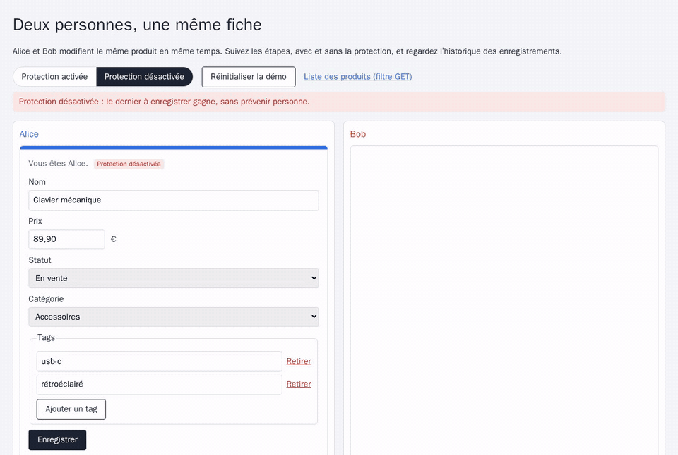
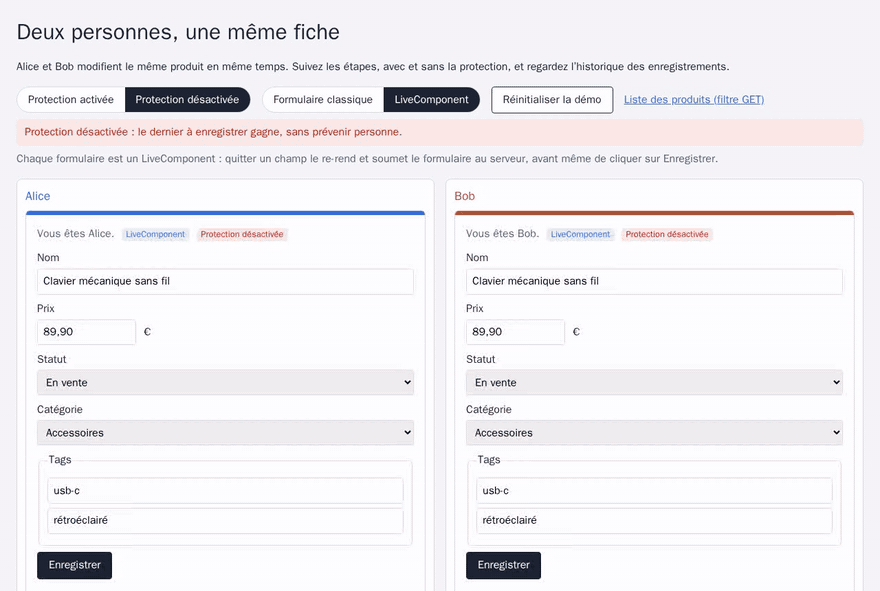

# Demo: two people, one record

A small back-office where Alice and Bob edit the same product side by side, with a switch to turn the
protection off and a history of every save. It shows what goes wrong without the protection, and how the
conflict is reported with it.



## Run it

You only need Docker:

```bash
docker compose up --build
```

Then open http://localhost:8080. Set `DEMO_PORT` to use another port, e.g. `DEMO_PORT=8091 docker compose up --build`.

Every start rebuilds the SQLite database with one product, and the "Reset the demo" button does the same
at any time.

## What to try

The page guides you through the main scenario:

1. Both forms are open on the same version of the product.
2. Bob changes the price and saves.
3. Alice, who still sees the old price, changes the name and saves.

With the protection off, Alice's save goes through, and the history shows her putting the old price back
without knowing it. With the protection on, her save is refused: the price field says Bob changed it and
shows his value, and her new name is kept. To save her values anyway, she has to tick a confirmation box;
sending the form again as is still gets refused.

The second switch, "LiveComponent", replaces both forms with the same form as a LiveComponent
(`src/Twig/Components/ProductLiveForm.php`). Leaving a field re-renders the component, which submits the form to
the server before anyone clicks Save: the case where a naive protection lets the conflict through. The
scenario plays out the same way: the conflict is spotted on the first re-render, which already shows the
confirmation box, and the save is refused until it is ticked.



Also worth trying:

- **Bob adjusts the stock** ("Adjust the stock instead"), then Alice saves: no conflict, since her form does
  not show the stock.
- **Bob saves without changing anything**: Alice is not bothered.
- **Bob adds a tag**: Alice is told the tag list changed.
- **The product list** has a GET filter: it works from a plain link, with no token.

## How the demo is built

The product form (`src/Form/ProductType.php`) knows nothing about the protection: enabling the bundle in
`config/bundles.php` is all it takes. The forms are bound to the Doctrine entity on purpose, with an
`EntityType` relation, because that is the common back-office setup the protection has to work with. A real
application would usually put a DTO in between; the protection does not care.

`?protection=0` only exists for the demo: it sets the `concurrency_protection` option of the form to false.
Who is editing comes from `?as=alice|bob`; there is no authentication.

The LiveComponent page loads its JavaScript (Stimulus and the `live` controller) through AssetMapper;
`bin/console importmap:install` downloads Stimulus when the image is built. In the component, the tag list is a
`LiveCollectionType` (`live_collection` option of `ProductType`): adding or removing a tag is a LiveComponent
action, and the server re-renders the list.

The price is stored in cents, as an integer, so that no float ever holds money.

## Tests

`tests/Integration/LiveComponentConflictTest.php` runs the same scenario through `ProductLiveForm`, server side
(the JavaScript is not involved).

The application tests replay each scenario with two browsers, Alice and Bob, each with its own cookies and
session, against a real SQLite database. They run in the demo image, since the PHP on the host may lack
`pdo_sqlite`:

```bash
docker compose run --rm demo composer qa
```

`e2e/record.mjs` plays the main scenario in Chromium, protection off then on (with Alice acknowledging the
conflict), and records it. Each step
waits for what it expects to see, so a broken demo fails there instead of producing a misleading video.
`e2e/live.mjs` does the same with the LiveComponent forms, then adds and removes a tag, in a real browser with the LiveComponent JavaScript
(`RECORD=1` keeps a video). Both run in the Playwright image, against a demo started on port 8091:

```bash
DEMO_PORT=8091 docker compose up -d --build
docker run --rm --network host -u "$(id -u):$(id -g)" -e HOME=/tmp -v "$PWD/e2e":/work -w /work mcr.microsoft.com/playwright:v1.65.1-noble sh -c 'npm ci && node record.mjs && node live.mjs'
ffmpeg -i e2e/output/*.webm -vf "fps=6,scale=880:-1:flags=lanczos,split[a][b];[a]palettegen=max_colors=80:stats_mode=diff[p];[b][p]paletteuse=dither=bayer:bayer_scale=4:diff_mode=rectangle" ../docs/demo.gif
```
